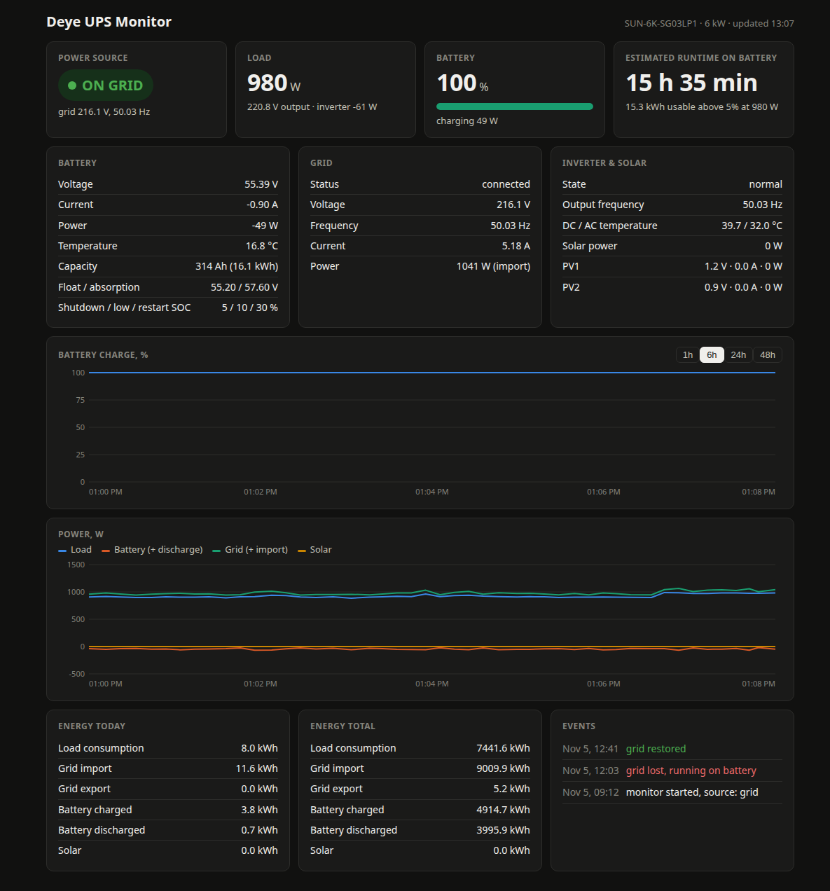

# deye-monitor

A small, dependency-free Go web server that turns a **Deye hybrid inverter** into
a readable home UPS dashboard. It polls the inverter through its Solarman
(LSW-3 / IGEN) WiFi logger stick on the local network, no cloud involved, and
shows:

- current **power source**: grid, battery, solar, or grid + battery
- load power, battery state of charge, voltage, current, temperature
- **estimated runtime on battery** at the present load
- grid voltage / frequency / import-export power, PV string readings, inverter temperatures
- battery charge settings (float, absorption, shutdown / low / restart SOC)
- **history charts** (SOC and power) for the last 1h to 48h with off-grid periods shaded
- energy counters for today and lifetime
- an **event log** of grid lost / restored (with outage duration), low battery, inverter state changes
- a **desktop notification** when the grid goes down and when it comes back

The page is embedded in the binary and loads nothing from the internet, so it
keeps working during an outage. JSON endpoints are available for other tools.



## Supported hardware

Tested with a Deye SUN-6K-SG03LP1 (single-phase hybrid) behind a Solarman
LSW-3 logger stick (firmware `LSW3_32U_5406_1.06`). It should work with any
single-phase Deye hybrid (`SUN-xK-SG0xLP1`, also sold as Sunsynk, Turbo Energy,
SolArk and others) that uses the same Modbus register map (holding registers
0-260). Three-phase models use registers 500 and up and would need a different
decoder; contributions welcome.

## Requirements

- Go 1.22 or newer to build
- the logger stick reachable on your LAN: TCP port **8899** open (that is the
  default for Solarman sticks; check with `nc -z <ip> 8899`)
- the **logger serial number**: the 10-digit number on the stick's sticker, or
  "Device serial number" on the stick's web UI (`http://<ip>/status.html`,
  default login `admin` / `admin`). This is *not* the inverter serial.
- `notify-send` (libnotify) for desktop notifications, optional

## Quick start

```sh
git clone https://github.com/0x00dec0de/deye-monitor.git
cd deye-monitor
go build -o deye-monitor .
./deye-monitor -inverter 192.168.1.50:8899 -serial 1234567890
```

Open http://localhost:8080.

### Options

| Flag | Env | Default | Meaning |
|---|---|---|---|
| `-inverter` | `INVERTER_ADDR` | required | logger `host:port` |
| `-serial` | `LOGGER_SERIAL` | required | logger serial number |
| `-slave` | `MODBUS_SLAVE` | `1` | Modbus slave id of the inverter |
| `-addr` | `LISTEN_ADDR` | `:8080` | HTTP listen address |
| `-interval` | `POLL_INTERVAL` | `10s` | poll interval (3s is a sensible minimum) |
| `-history` | `HISTORY` | `48h` | how much history to keep |
| `-data` | `DATA_FILE` | `history.json` | where history and events are persisted (`''` to disable) |
| `-notify-cmd` | `NOTIFY_CMD` | notify-send (see below) | command run on grid events (`''` to disable) |

### JSON API

- `GET /api/status` – latest decoded reading, poll error state, event list
- `GET /api/history?range=6h` – thinned samples for the charts

## Run as a service

The unit in `deploy/` is a systemd **user** service, so the notification
command runs inside your desktop session. Edit the paths, inverter address and
serial in the file first.

```sh
cp deploy/deye-monitor.service ~/.config/systemd/user/
systemctl --user daemon-reload
systemctl --user enable --now deye-monitor
loginctl enable-linger $USER   # keep it running at boot, before login
journalctl --user -u deye-monitor -f
```

On a headless box (Raspberry Pi, NAS) a plain system unit works too; just set
`-notify-cmd` to something that does not need a desktop, or to `''`.

## Notifications

On **grid lost**, **grid restored** and **low battery** the monitor runs the
`-notify-cmd` shell command. The default is a desktop notification:

```sh
notify-send -a "Deye UPS" -u "$EVENT_URGENCY" -i battery "Deye: $EVENT_MESSAGE" "$EVENT_TIME"
```

Grid lost and low battery use `critical` urgency, so the popup stays until
dismissed. The command gets `EVENT_KIND` (`grid_lost`, `grid_restored`,
`low_battery`), `EVENT_MESSAGE`, `EVENT_URGENCY` and `EVENT_TIME` in its
environment, so it is easy to swap for Telegram, email, Home Assistant or
anything else, for example:

```sh
./deye-monitor ... -notify-cmd 'curl -s "https://api.telegram.org/bot$TOKEN/sendMessage" -d chat_id=$CHAT -d "text=$EVENT_MESSAGE"'
```

## How it works

- `solarman.go` implements the Solarman V5 framing (TCP 8899) that tunnels
  Modbus RTU to the inverter, including the frame checksum and Modbus CRC.
- `deye.go` reads holding registers 0-260 in three chunks and decodes the
  single-phase hybrid register map.
- `store.go` keeps the history ring and event log in memory and saves them to
  the data file once a minute, so a restart does not lose the charts.
- `web/index.html` is the dashboard, embedded with `go:embed`.

Grid presence comes from the inverter's grid-connected register plus a
grid-voltage sanity check. Losing the TCP connection to the logger stick (flaky
WiFi is common) is deliberately *not* an event: after three consecutive failed
polls a banner appears at the top of the page with the last known values, and
it disappears when polling recovers, so the event list only ever contains power
events. The runtime estimate is the usable energy above the
inverter's shutdown SOC, assuming a 51.2 V nominal battery and the capacity the
inverter reports, divided by the present load (or the real discharge power when
already on battery). It is an estimate, not a BMS value.

The logger stick's own web UI shows nonsense energy totals for these inverters;
all values here come from the Modbus registers.

## License

MIT, see [LICENSE](LICENSE).
